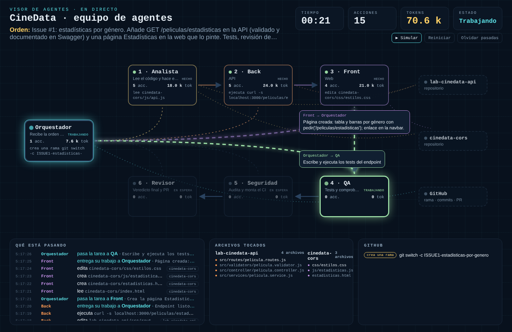

# Visor de agentes

Panel en directo para **ver cómo trabaja un equipo de agentes de IA**: quién recibe la orden, a quién se la pasa, qué archivos toca cada agente, cuántos tokens gasta y cómo acaba todo en una pull request.

Funciona con **Claude Code**, con **OpenCode** (modelos gratuitos o locales) y con cualquier otro sistema que pueda enviar un JSON por HTTP.



- Diagrama del pipeline: orquestador, agentes numerados y repositorios.
- Flechas animadas cuando un agente delega o entrega su trabajo, con un bocadillo con el mensaje.
- Registro de cada acción (lee, edita, ejecuta, lanza tests, hace commit…).
- Tokens por agente y totales, tiempo y número de acciones.
- Archivos tocados por repositorio y estado de GitHub (PR y Actions).
- Comparación entre pasadas: «Pasada anterior: X → ahora Y · −Z %».
- Botón **Simular** con una ejecución de ejemplo, sin agentes ni claves.

Sin dependencias: solo Node.js.

---

## Índice

1. [Requisitos](#1-requisitos)
2. [Puesta en marcha en 2 minutos](#2-puesta-en-marcha-en-2-minutos)
3. [Configurar tus repositorios](#3-configurar-tus-repositorios)
4. [Conectar Claude Code](#4-conectar-claude-code)
5. [Conectar OpenCode (gratis)](#5-conectar-opencode-gratis)
6. [Conectar otro sistema de agentes](#6-conectar-otro-sistema-de-agentes)
7. [La skill «telegrafés» y la comparación de pasadas](#7-la-skill-telegrafés-y-la-comparación-de-pasadas)
8. [Repetir una demo desde cero](#8-repetir-una-demo-desde-cero)
9. [Estructura del proyecto](#9-estructura-del-proyecto)
10. [Problemas frecuentes](#10-problemas-frecuentes)

---

## 1. Requisitos

| Necesitas | Para qué | Comprobar |
|---|---|---|
| **Node.js 18 o superior** | Ejecutar el visor | `node --version` |
| **Git** | Trabajar con los repos | `git --version` |
| Claude Code **u** OpenCode | Los agentes | `claude --version` · `opencode --version` |
| GitHub CLI *(opcional)* | Ver PR y Actions en el panel, y que los agentes abran PR | `gh auth status` |

---

## 2. Puesta en marcha en 2 minutos

```bash
git clone <url-de-este-repo> visor-agentes
cd visor-agentes
npm start
```

Abre **http://localhost:4545** y pulsa **▶ Simular**. En unos 40 segundos verás una ejecución completa de seis agentes. Si esto funciona, el visor está bien instalado.

> Para cambiar de puerto: `PORT=4600 npm start` (en Windows PowerShell: `$env:PORT=4600; npm start`).

---

## 3. Configurar tus repositorios

Todo lo que se adapta a tu proyecto está en **`config.json`**:

```json
{
  "titulo": "CineData · equipo de agentes",
  "puerto": 4545,
  "repos": [
    { "id": "api", "nombre": "lab-cinedata-api", "ruta": "../lab-cinedata-api", "github": "" },
    { "id": "web", "nombre": "cinedata-cors", "ruta": "../cinedata-cors", "github": "" }
  ],
  "orden": ["orquestador", "analista", "back", "front", "qa", "seguridad", "revisor"],
  "agentes": {
    "analista": { "nombre": "Analista", "rol": "Lee el código y hace el plan", "color": "#FFD166" }
  }
}
```

| Campo | Qué poner |
|---|---|
| `titulo` | El nombre que sale arriba del panel |
| `repos[].ruta` | **Ruta a la carpeta del repo, relativa a la carpeta del visor.** Con esta estructura, `../lab-cinedata-api` |
| `repos[].nombre` | Nombre que se ve en el panel |
| `repos[].github` | `usuario/repositorio` en GitHub para ver PR y Actions. Vacío si no lo quieres |
| `orden` | Agentes en el orden del pipeline. Tienen que llamarse **igual que los archivos** de tus agentes (`analista.md` → `analista`) |
| `agentes` | Nombre visible, rol y color de cada agente. Uno que no aparezca aquí se muestra igual, con un color automático |

Estructura recomendada:

```
proyectos/
├── visor-agentes/
├── lab-cinedata-api/
└── cinedata-cors/
```

> Puedes tener un solo repositorio o varios. El visor sabe a qué repo pertenece cada archivo por el nombre de su carpeta.

---

## 4. Conectar Claude Code

Necesitas una suscripción de Claude (Pro o Max) o una API key.

### 4.1 Instalar los agentes y los hooks en tu proyecto

Desde la carpeta del visor:

```bash
node scripts/instalar.mjs claude ../lab-cinedata-api
```

Esto hace tres cosas en `lab-cinedata-api`:

- Copia **seis agentes de ejemplo** a `.claude/agents/` (analista, back, front, qa, seguridad y revisor). Si ya tienes agentes con esos nombres, no los toca (usa `--forzar` para sobrescribirlos).
- Escribe los **hooks** en `.claude/settings.local.json`. Cada vez que Claude hace algo, el hook avisa al visor. La ruta va entre comillas, así que funciona aunque tenga espacios.
- Añade `.claude/settings.local.json` al `.gitignore`, porque contiene rutas de tu ordenador.

### 4.2 Arrancar

Necesitas tres terminales:

```bash
# 1 · el visor
cd visor-agentes && npm start

# 2 · tu API, como siempre
cd lab-cinedata-api && npm run dev

# 3 · Claude Code, con acceso también al repo de la web
cd lab-cinedata-api && claude --add-dir ../cinedata-cors
```

Abre http://localhost:4545.

### 4.3 Comprobar

Dentro de Claude:

1. Abajo a la derecha **no** debe poner «Not logged in». Si lo pone: `/login` → cuenta de Claude.
2. Pregunta: «¿Qué subagentes tienes disponibles? Solo los nombres». Deben salir los seis.
3. `/hooks`: deben aparecer seis eventos con `enviar.mjs`.
4. Pide: «lee package.json». En el visor debe aparecer «Orquestador · lee package.json».

### 4.4 La orden

Ejemplo para dos repos (cambia `N` por el número de tu issue y `TU_USUARIO` por el tuyo):

```
Issue #N de lab-cinedata-api: quiero estadísticas por género.
Añade GET /peliculas/estadisticas en la API (por cada género: total de películas y nota media,
ordenado por nota media; query opcional ?minimo=N entre 1 y 50, validada con express-validator
y documentada con @openapi) y una página Estadísticas en cinedata-cors que lo pinte.

Trabaja SOLO como orquestador y delega en este orden: analista → back → front → qa → seguridad → revisor.
Antes de que empiece back, crea la rama ISSUEN-estadisticas-por-genero en los dos repos.
Pásale a cada agente lo que necesite del anterior.
El revisor abre una PR en cada repo: la de la API con "Closes #N" y la de la web con
"Refs TU_USUARIO/lab-cinedata-api#N". No hagas merge: la revisión final es humana.
```

---

## 5. Conectar OpenCode (gratis)

[OpenCode](https://opencode.ai) es un agente de código abierto que funciona con modelos gratuitos, con modelos locales (Ollama) o con tu propia clave de pago.

### 5.1 Instalar OpenCode y conectar un modelo gratuito

```bash
npm install -g opencode-ai
opencode --version
```

Abre OpenCode en cualquier carpeta (`opencode`) y escribe:

```
/connect
```

| Proveedor | Cómo | Notas |
|---|---|---|
| **OpenCode Zen** | Elige *opencode* → inicia sesión en opencode.ai/auth → pega la clave | Varios modelos marcados como *free* |
| **Google AI Studio** | aistudio.google.com → *Get API key* → `/connect` → *Google* | Buenos modelos para analizar y revisar |
| **OpenRouter** | openrouter.ai → *Keys* → `/connect` → *OpenRouter* | Modelos `:free` con límite diario |
| **Ollama (local)** | `ollama pull <modelo>` y configurarlo como proveedor | Necesita mucha RAM; mejor solo para leer |

Con `/models` eliges el modelo. Para un equipo de agentes elige uno que **use bien herramientas**: los más pequeños a veces describen el cambio en lugar de hacerlo.

### 5.2 Instalar los agentes y el plugin en tu proyecto

Desde la carpeta del visor:

```bash
node scripts/instalar.mjs opencode ../lab-cinedata-api
```

Esto copia en tu proyecto:

- **Seis agentes** en `.opencode/agents/` con `mode: subagent`. El analista y el revisor no pueden editar archivos.
- El **plugin** `.opencode/plugins/visor.js`, que avisa al visor de cada delegación, acción y tokens.

Si el visor corre en otro ordenador (por ejemplo, el del profesor proyectado), indica su dirección:

```bash
node scripts/instalar.mjs opencode ../lab-cinedata-api --url http://192.168.1.20:4545
```

### 5.3 Arrancar y comprobar

```bash
# 1 · el visor
cd visor-agentes && npm start

# 2 · OpenCode en tu proyecto
cd lab-cinedata-api
opencode agent list      # deben salir analista, back, front, qa, revisor y seguridad como (subagent)
opencode
```

Escribe una orden sencilla: «lee package.json». En el visor debe aparecer la orden y la acción.

### 5.4 La orden

En OpenCode el agente principal (*build*) es el orquestador. Pídele que delegue:

```
Usa los subagentes analista, back, qa y revisor, en ese orden, para esta tarea:
añade GET /peliculas/estadisticas (por género: total y nota media; ?minimo validado entre 1 y 50,
documentado con @openapi). El analista hace el plan, back lo implementa, qa escribe y ejecuta
los tests y revisor revisa el diff. Tú solo coordinas: no edites código.
```

También puedes llamar a un subagente directamente escribiendo `@analista` al principio del mensaje.

---

## 6. Conectar otro sistema de agentes

Cualquier herramienta que pueda hacer una petición HTTP puede usar el visor: Codex, Gemini CLI, un script propio con la API de un modelo, n8n…

Envía eventos a **`POST http://localhost:4545/api/eventos`**, uno o una lista:

```bash
curl -X POST http://localhost:4545/api/eventos \
  -H "Content-Type: application/json" \
  -d '[
    { "tipo": "orden", "texto": "Añade el endpoint de favoritos" },
    { "tipo": "delegar", "de": "orquestador", "a": "analista", "texto": "Haz el plan" },
    { "tipo": "accion", "agente": "analista", "herramienta": "read", "args": { "filePath": "/ruta/lab-cinedata-api/src/routes/pelicula.routes.js" } },
    { "tipo": "tokens", "agente": "analista", "total": 12000 },
    { "tipo": "entregar", "de": "analista", "a": "orquestador", "texto": "Plan listo" },
    { "tipo": "turno-fin" }
  ]'
```

| `tipo` | Campos | Qué hace en el panel |
|---|---|---|
| `inicio` | — | Limpia el panel para una ejecución nueva |
| `orden` | `texto` | Muestra la orden y arranca el reloj |
| `delegar` | `de`, `a`, `texto` | Flecha del que delega al agente, y lo enciende |
| `entregar` | `de`, `a`, `texto` | Flecha de vuelta y marca al agente como hecho |
| `accion` | `agente`, `herramienta`, `args` | Línea en el registro; si toca un archivo de un repo, flecha al repo |
| `resultado` | `agente`, `salida` *o* `ok` + `texto` | Línea verde o roja (detecta resultados de Jest/Vitest en `salida`) |
| `tokens` | `agente` + `total`, *o* `porAgente` | Tokens acumulados de ese agente (valor total, no incremento) |
| `estado` | `agente`, `estado` | `trabajando`, `hecho` o `esperando` |
| `turno-fin` | — | Termina si ningún agente sigue trabajando |

En `accion`, las herramientas `read`, `write`, `edit`, `bash`, `grep`, `glob` y `webfetch` se reconocen en mayúsculas o minúsculas. En `args`, las rutas pueden venir como `file_path`, `filePath` o `path`, y los comandos como `command`. Los comandos `git commit`, `git push` y `gh pr create` se pintan como acciones de GitHub.

---

## 7. La skill «telegrafés» y la comparación de pasadas

`plantillas/claude/skills/telegrafes/SKILL.md` es una skill que define un **idioma compacto** para que los agentes se comuniquen gastando menos tokens, más unas **reglas para leer menos contexto**.

Para comparar con y sin skill:

1. Pulsa **Olvidar pasadas** en el visor.
2. Lanza la orden **sin** la skill y espera al cartel final.
3. Deja los repos limpios (sección 8).
4. Instala la skill y reinicia el agente:
   ```bash
   node scripts/instalar.mjs claude ../lab-cinedata-api --skill      # o: opencode
   ```
5. **Reiniciar** en el visor y la misma orden, añadiendo: «Usa la skill telegrafes para toda la comunicación con los agentes».
6. El cartel final enseña la diferencia con la pasada anterior.

> Instala la skill **después** de la primera pasada: si está en el proyecto desde el principio, el agente puede usarla por su cuenta y no habrá comparación.

Las pasadas se guardan en el navegador (las últimas diez).

---

## 8. Repetir una demo desde cero

```bash
npm run reset
```

Para cada repo de `config.json`:

- cierra las PR abiertas y borra su rama en GitHub;
- vuelve a la rama principal y hace `pull`;
- borra las ramas locales;
- avisa si hay cambios sin commit.

No borra archivos sin seguimiento, así que `.claude/` y `.opencode/` se quedan. Después pulsa **Reiniciar** en el visor y empieza una sesión nueva en el agente (`/clear` en Claude, `/new` en OpenCode).

---

## 9. Estructura del proyecto

```
visor-agentes/
├── config.json                 ← lo que adaptas a tu proyecto
├── src/server/
│   ├── index.js                ← arranque: monta las piezas
│   ├── config.js               ← lee config.json
│   ├── core/
│   │   ├── sesion.js           ← modelo: estado de la ejecución y eventos del panel
│   │   ├── clasificador.js     ← traduce herramientas y comandos a acciones legibles
│   │   └── difusor.js          ← envía los eventos al navegador (SSE)
│   ├── adaptadores/
│   │   └── claude.js           ← convierte los hooks de Claude Code en eventos del visor
│   ├── servicios/
│   │   ├── github.js           ← consulta PR y Actions con gh
│   │   └── demo.js             ← reproduce datos/demo.json
│   └── http/
│       ├── servidor.js         ← rutas de la API
│       └── estaticos.js        ← sirve public/
├── public/                     ← el panel
│   ├── index.html
│   ├── css/visor.css
│   └── js/
│       ├── main.js             ← arranque y conexión
│       ├── app.js              ← reparte cada evento a su vista
│       ├── diagrama.js         ← nodos, flechas y animaciones
│       ├── paneles.js          ← registro, archivos y GitHub
│       ├── marcador.js         ← tiempo, acciones, tokens y cartel final
│       ├── pasadas.js          ← comparación entre ejecuciones
│       ├── catalogo.js         ← nombres y colores de agentes y repos
│       └── formato.js
├── hooks/claude/enviar.mjs     ← hook que ejecuta Claude Code
├── plugins/opencode/visor.js   ← plugin que carga OpenCode
├── plantillas/                 ← agentes y skill que copia el instalador
├── scripts/
│   ├── instalar.mjs
│   └── reset-demo.mjs
└── datos/demo.json             ← ejecución de ejemplo del botón Simular
```

Cómo fluye un evento:

```
Claude Code ──hook──► POST /api/claude ──► adaptador Claude ─┐
OpenCode ───plugin──► POST /api/eventos ────────────────────┼─► Sesión ─► Difusor ─► navegador (SSE) ─► App ─► vistas
Otros ──────HTTP────► POST /api/eventos ────────────────────┘
```

Para añadir otro sistema con su propio formato, crea un adaptador en `src/server/adaptadores/` que traduzca sus eventos a los de la tabla de la sección 6, igual que hace `claude.js`.

---

## 10. Problemas frecuentes

| Síntoma | Causa | Solución |
|---|---|---|
| El panel no se mueve al usar Claude | Hooks no cargados | Abre Claude **desde** la carpeta del proyecto donde instalaste. `/hooks` debe listarlos. Si no, repite `node scripts/instalar.mjs claude <ruta>` |
| «Not logged in · Run /login» en Claude | Sin sesión en ese ordenador | `/login` → cuenta de Claude (no API key, salvo que la uses) |
| `/agents` dice «The /agents wizard has been removed» | En versiones nuevas los agentes son solo archivos | No es un error. Pregunta «¿qué subagentes tienes?» |
| Todo aparece como «Orquestador» | El agente no delegó | Pide explícitamente que use los subagentes por su nombre |
| El panel no se mueve con OpenCode | Plugin no cargado o URL distinta | Comprueba `.opencode/plugins/visor.js` y su `VISOR_URL`. Reinicia OpenCode |
| `opencode agent list` no muestra los agentes | Archivos fuera de sitio | Deben estar en `.opencode/agents/` del proyecto donde abres OpenCode |
| El modelo dice que ha creado un archivo pero no existe | Modelo pequeño que no usa bien las herramientas | Cambia de modelo con `/models` |
| «Rate limit», 429 o cuota agotada | Límite del plan gratuito | Cambia a otro proveedor con `/models` |
| Rutas con espacios («Proyectos VS») fallan | Comando del hook sin comillas | El instalador ya las pone. Si lo editaste a mano: `node "/ruta con espacios/hooks/claude/enviar.mjs"` |
| El panel de GitHub dice «No se pudo usar gh» | gh sin sesión o repo mal escrito | `gh auth status` y revisa `github` en `config.json` |
| `EADDRINUSE` al arrancar | Puerto ocupado | `PORT=4600 npm start` y reinstala con `--url http://localhost:4600` |
| VS Code: «Error loading webview» al abrir un `.md` | Fallo de la vista previa de VS Code | `Ctrl+Shift+P` → *Developer: Reload Window*. O botón derecho → *Open With… → Text Editor* |

---

Hecho para el bootcamp Full Stack de AprenTIC (The Bridge). Licencia MIT.
